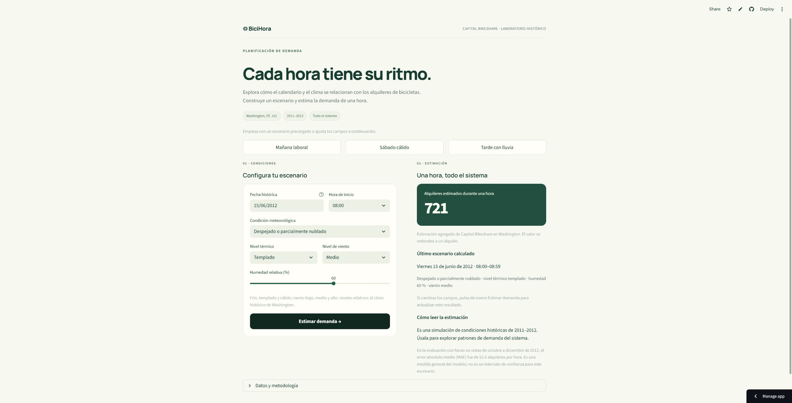

# BiciHora · demanda horaria de bicicletas

Proyecto final de **Fundamentos de Aprendizaje Automático**. BiciHora estima el total de alquileres durante una hora en Capital Bikeshare, Washington, para explorar escenarios de planificación con calendario y clima de 2011–2012.

El desarrollo y entrenamiento se realizan en un notebook compatible con **Google Colab en CPU**. La interfaz Streamlit carga el modelo guardado y permite probar tres ejemplos o configurar un escenario. El alcance es histórico y agregado para todo el sistema.

## Abrir el proyecto

- **Notebook:** [model_development.ipynb](model_development.ipynb).
- **Colab desde GitHub:** [abrir el notebook ejecutado en Google Colab](https://colab.research.google.com/github/Mateoloperaortiz/bike-demand-final-project/blob/main/model_development.ipynb).
- **Código:** [repositorio público en GitHub](https://github.com/Mateoloperaortiz/bike-demand-final-project). La versión `v1.1` está publicada; `main` contiene el notebook con resultados de la ejecución real de Colab.
- **App pública:** [abrir BiciHora](https://bicihora-mateolopera.streamlit.app/), publicada en Streamlit Community Cloud; sus tres escenarios están verificados en Chrome.
- **Video de entrega:** [demostración de 120 segundos](media/demo_public_120s.mp4) y [subtítulos SRT](media/demo_public_120s.srt), montaje de capturas reales del sitio publicado, con texto en pantalla y sin audio.



### Ejecutar en Google Colab

1. Abrir el notebook ejecutado de **`main`**. También se puede descargar y usar **Archivo → Subir notebook**. Sus salidas muestran la ejecución real de Colab; al volver a ejecutarlo, la primera celda descarga el código de la versión fija **`v1.1`** para reproducir el experimento.
2. En **Entorno de ejecución → Cambiar tipo de entorno de ejecución**, elegir **Python 3**, acelerador **Ninguno / CPU** y **Versión del entorno: `2026.07`**. Esa versión usa Python **3.12.13** y está fijada en los metadatos del notebook. Comprobar la selección antes de conectar; en la prueba real el entorno predeterminado ofreció Python 3.13.
3. Ejecutar la primera celda de preparación. Instala `requirements-colab.txt` y detecta bibliotecas antiguas ya cargadas. Si aparece la indicación de reinicio, usar **Entorno de ejecución → Reiniciar sesión** y después **Ejecutar todas** desde el principio. La instalación en disco no sustituye una biblioteca que ya está importada en memoria.
4. La preparación descarga y comprueba los datos. El notebook desarrolla el EDA, ejecuta la comparación, selecciona el modelo y guarda la evaluación y los artefactos. No se necesita subir manualmente `hour.csv`.
5. La última celda descarga `resultados_bike_demand.zip`, con `artifacts/`, `reportes/` y `figuras/`. Descargar también el notebook **con sus salidas** desde **Archivo → Descargar → .ipynb**. Conservar los archivos de resultados junto al código; el modelo necesita sus metadatos para cargar en la app.

Google documenta la selección de versiones anteriores y Python 3.12.13 para `2026.07` en su [FAQ de versiones del entorno](https://research.google.com/colaboratory/runtime-version-faq.html). Conectar a una versión anterior puede tardar unos minutos. Si esa versión deja de estar disponible, elegir otro entorno Python 3.12 compatible y volver a verificar la ejecución y las predicciones.

Colab permite cargar notebooks desde GitHub o un archivo, pero los archivos de su máquina virtual son temporales. Guardar el notebook no guarda automáticamente el modelo ni los reportes de esa máquina. Véase la [FAQ oficial de Colab](https://research.google.com/colaboratory/faq.html).

### Ejecutar localmente

Desde la raíz de este proyecto, con Python **3.12**:

```bash
python -m venv .venv
```

En Windows PowerShell:

```powershell
.\.venv\Scripts\Activate.ps1
```

En macOS/Linux:

```bash
source .venv/bin/activate
```

Instalar las dependencias de desarrollo y ejecutar:

```bash
python -m pip install -r requirements-dev.txt
python train_model.py --jobs 2
python -m streamlit run streamlit_app.py
```

El entrenamiento vuelve a ejecutar todas las búsquedas y la evaluación; para explorar el modelo entregado basta instalar `requirements.txt` y ejecutar Streamlit. No usar ejecuciones repetidas sobre prueba para cambiar hiperparámetros.

## Datos y metodología

La fuente es [UCI Bike Sharing, dataset 275](https://archive.ics.uci.edu/dataset/275/bike+sharing+dataset). Se usa `hour.csv`, con **17.379 filas y 17 columnas** verificadas. La ficha web anuncia 17.389 instancias; el conteo del archivo horario determina los tamaños usados aquí.

SHA-256 esperado del CSV:

```text
e03de4ee4ef4dc376ac6e04bf829673c6269e8eba5c60fa121640fa2f829504f
```

La respuesta es `cnt`. Se excluyen `casual` y `registered`, cuya suma revela esa respuesta, además de `instant`. El calendario se obtiene de fecha y hora. Se incluyen condición meteorológica, temperatura, humedad y viento normalizados; se excluyen `season` y `atemp` por redundancia y discrepancias documentales. No se convierten temperatura o viento a unidades físicas a partir de documentación ambigua. Las tres observaciones de clima extremo (categoría 4) se agrupan con la categoría adversa 3 mediante una regla fija. Se mantienen los picos legítimos y las **165 horas ausentes** no se inventan como ceros.

| Conjunto | Periodo | Registros |
|---|---|---:|
| Entrenamiento | Enero de 2011–junio de 2012 | 13.003 |
| Validación | Julio–septiembre de 2012 | 2.208 |
| Prueba | Octubre–diciembre de 2012 | 2.168 |

El EDA se limita a entrenamiento. Se comparan **Ridge, Random Forest y Gradient Boosting con histogramas**, más una referencia de mediana. Los pipelines ajustan transformaciones dentro de cada partición; Ridge codifica categorías y escala variables continuas.

Los hiperparámetros se buscan en cinco bloques temporales expansivos de 30 días, con dos días de separación, exclusivamente dentro del entrenamiento. Se prueban 4 configuraciones de Ridge, 6 de Random Forest y 8 de Gradient Boosting. El ganador se elige por **MAE en validación**, con RMSE para desempatar; se reajusta con entrenamiento más validación y se evalúa una vez en prueba. La predicción se limita a valores no negativos tanto al evaluar como en la app.

## Resultados y archivos

La ejecución seleccionó **Gradient Boosting con histogramas**. En las **2.168 horas de prueba**, su MAE fue **52,62 alquileres/hora**, frente a **158,81** de la referencia de mediana: una reducción del MAE del **66,87 %**.

| Modelo final en prueba | MAE (alquileres/h) | RMSE (alquileres/h) | R² |
|---|---:|---:|---:|
| Gradient Boosting | 52,62 | 76,97 | 0,8542 |
| Mediana | 158,81 | 217,32 | −0,1622 |

La selección se hizo antes de abrir prueba. El MAE de validación fue 47,15 para Gradient Boosting, 48,04 para Random Forest, 111,21 para Ridge y 213,70 para la mediana. El ganador usa `learning_rate=0.1`, `max_leaf_nodes=31`, `min_samples_leaf=10` y `max_iter=200`, con `early_stopping=False`. Su MAE de ajuste inicial fue 22,40; la diferencia con validación evidencia que el error de entrenamiento no estima el desempeño futuro.

Las cifras exactas y búsquedas están en [model_comparison.csv](reportes/model_comparison.csv), [test_metrics.csv](reportes/test_metrics.csv) y [training_summary.json](reportes/training_summary.json). **MAE** es la métrica principal; **RMSE** penaliza más los errores grandes y **R²** compara variación explicada con una referencia basada en la media. Ninguna de ellas es un porcentaje de predicciones correctas ni un intervalo individual.

El mayor MAE por hora en prueba aparece a las **17:00: 134,21 alquileres/hora**. El promedio global oculta este límite en la hora pico; véase [el análisis por segmentos](reportes/error_segments.csv).

| Archivo o carpeta | Contenido |
|---|---|
| `model_development.ipynb` | Desarrollo explicado, EDA, comparación y evaluación. |
| `bike_demand/` | Descarga, preparación, entrenamiento e inferencia compartidos. |
| `train_model.py` | Entrenamiento completo desde la terminal. |
| `streamlit_app.py` | Formulario y presentación de resultados. |
| `artifacts/model.joblib` | Pipeline final ajustado. |
| `artifacts/metadata.json` | Fuente, versiones, métricas, calendario, niveles y ejemplos. |
| `artifacts/reference_predictions.json` | Escenarios para verificar resultados al recargar. |
| `reportes/` | Auditoría, particiones, búsquedas, métricas, errores e importancia. |
| `figuras/` | Imágenes del EDA y de la evaluación generadas por el notebook. |
| `requirements.txt` / `requirements-dev.txt` / `requirements-colab.txt` | Dependencias fijadas para la app, el desarrollo local y Colab. |
| `docs/` | Reajuste, sustentación, rúbrica y guion del video. |
| `media/demo_public_120s.mp4` / `.srt` | Video de entrega de 120 segundos: capturas reales del sitio publicado, texto en pantalla y subtítulos, sin audio. |
| `media/demo_public_metadata.json` | Duración, escenas, URL y procedencia del video público. |
| `media/demo_local_120s.mp4` / `.srt` | Borrador local conservado como material previo. |

El formulario utiliza percentiles **25, 50 y 75** de temperatura y viento del entrenamiento final para los niveles relativos. Calcula calendario y festivos automáticamente y acepta fechas únicamente entre 2011-01-01 y 2012-12-31. Ofrece las tres categorías meteorológicas con evidencia suficiente para la demostración; la categoría extrema, con solo tres observaciones en el archivo, no se ofrece como escenario del formulario. Tras editar o cargar un ejemplo hay que pulsar **Estimar demanda**.

## Reproducibilidad y despliegue

El modelo entregado se entrenó en **Colab CPU, entorno `2026.07`, Python 3.12.13**. Se verificó su carga en Windows con **Python 3.12.14** y en Streamlit Community Cloud con **Python 3.12.15**. Las dependencias del servidor coinciden: NumPy 2.2.6, pandas 2.3.3, SciPy 1.16.3, scikit-learn 1.7.2 y joblib 1.5.2.

Los metadatos registran el entorno que produjo el modelo y su hash. El cargador comprueba la misma versión mayor y menor de Python, las versiones exactas de las cinco bibliotecas, el esquema y el hash del modelo. El parche de Python queda registrado; la compatibilidad se confirmó con predicciones de referencia, la suite local y los escenarios del servidor. Scikit-learn requiere conservar las versiones de las dependencias entre entrenamiento e inferencia; consultar su [documentación de persistencia](https://scikit-learn.org/stable/model_persistence.html).

El experimento de Colab conserva el código y las dependencias históricos de **`v1.1`**. La interfaz y las herramientas de desarrollo de `main` se actualizaron a **Streamlit 1.54.0, nbconvert 7.17.1 y pytest 9.0.3**. Las cinco bibliotecas del pipeline, el modelo y los resultados del notebook permanecen iguales; no se requiere que Streamlit o las herramientas de desarrollo coincidan con el entorno histórico de Colab.

La app está publicada desde `main` y `streamlit_app.py`. Para reproducir el despliegue en Streamlit Community Cloud:

1. Subir el proyecto completo al repositorio, incluidos `artifacts/` y `requirements.txt`.
2. En [Streamlit Community Cloud](https://share.streamlit.io/), crear una app con el repositorio `Mateoloperaortiz/bike-demand-final-project`, rama `main` y archivo `streamlit_app.py`.
3. Seleccionar **Python 3.12** en las opciones avanzadas, comprobar la compatibilidad con los metadatos y desplegar. No se necesitan claves de API para este proyecto.
4. Abrir la URL resultante en incógnito, probar los tres ejemplos y comprobar que la app vuelve a cargar después de reiniciarla. Añadir el enlace y el resultado de estas comprobaciones a este README.

Si se vuelve a entrenar en un Colab que usa otra versión de Python, registrar ese entorno y preparar el despliegue con la misma versión compatible; no sustituir un artefacto sin revisar su entorno. Las instrucciones de publicación se basan en la [guía oficial de Streamlit](https://docs.streamlit.io/deploy/streamlit-community-cloud/deploy-your-app/deploy).

### Estado de verificación

El notebook se ejecutó de principio a fin tanto localmente como en una **sesión real de Google Colab CPU, entorno `2026.07`, Python 3.12.13**. La ejecución de Colab tiene **18 celdas de código numeradas de 1 a 18, sin errores**. Se descargaron el notebook con sus salidas y el ZIP de resultados, cuyos **28 archivos** de `artifacts/`, `reportes/` y `figuras/` se importaron a esta entrega.

Todas las métricas, predicciones de prueba, cinco referencias y SHA-256 del modelo coincidieron con la ejecución local. El modelo de Colab carga en Windows Python 3.12.14 y mantiene **50 pruebas aprobadas** con las dependencias actuales. La [app publicada](https://bicihora-mateolopera.streamlit.app/) muestra los mismos **721, 572 y 358** alquileres/hora en sus tres escenarios verificados en Chrome. Su configuración de acceso está marcada como pública y buscable. Tras **Reboot**, volvió el formulario y el primer escenario volvió a producir **721**.

`v1.1` está publicada en GitHub y el notebook ejecutado se conserva en `main`. El video público fue revisado: **120,0 s**, siete escenas, 1.920 × 1.080, H.264, 24 fps, con texto y subtítulos, sin audio. El usuario confirmó que la app **abre y calcula sin iniciar sesión en una ventana de incógnito**; esta comprobación es manual. Un cliente independiente sin credenciales también reprodujo las tres predicciones en el servidor **Streamlit 1.54.0**. Una fecha forzada fuera del periodo mostró un aviso en español, sin excepciones ni nueva predicción; al corregirla, volvió a calcular **721**. El detalle está en [public_access_check.json](reportes/public_access_check.json) y [verificacion.md](docs/verificacion.md). No se ha forzado una suspensión del alojamiento.

Para repetir las pruebas después de generar o descargar los artefactos, con las dependencias de desarrollo instaladas:

```bash
python -m pytest -q
```

Las pruebas verifican los conjuntos temporales sin solapamiento, cinco bloques completos de CV con separación de dos días, el presupuesto de búsqueda y transformaciones ajustadas solo con entrenamiento. Comprueban los hashes del ZIP/CSV, rechazo de fuentes alteradas y las métricas recalculadas independientemente contra las respuestas reales de prueba.

También verifican entradas inválidas, calendario, niveles exportados, esquema, hash del modelo, recarga de predicciones y los tres ejemplos de la interfaz. Incluyen las regresiones de fechas 2010/2013, recuperación tras corregir la entrada, inicio sin artefactos y una sesión nueva; además, se verificó el reinicio real del alojamiento. El estado de las comprobaciones de acceso y el cliente técnico [check_public_access.py](scripts/check_public_access.py) están en [verificación](docs/verificacion.md).

## Entrega y sustentación

- [Correspondencia con los apartados 3.1–3.9 del taller](docs/correspondencia_requisitos.md).
- [Sustentación: decisiones, métricas y limitaciones](docs/sustentacion.md).
- [Estrategia de reajuste y recuperación](docs/estrategia_reajuste.md).
- [Guion de video de dos minutos](docs/guion_video.md).
- [Video final del sitio publicado](media/demo_public_120s.mp4) y [subtítulos](media/demo_public_120s.srt).
- [Borrador local conservado](media/demo_local_120s.mp4) y [subtítulos locales](media/demo_local_120s.srt).
- [Verificaciones de Colab, app publicada y entrega](docs/verificacion.md).

La política de reajuste propone revisión mensual de precisión y distribución cuando existan resultados observados, investigación ante una subida del MAE superior al 20 % durante dos meses y revisión trimestral. Son supuestos iniciales; no hay monitoreo en vivo en este prototipo.

El modelo usa clima observado y datos históricos. No estima inventario por estación, viajes perdidos ni demanda actual. Aplicarlo a una operación reciente requiere nueva información y validación.

La meta de preparación del plan es el **1 de noviembre de 2026**. El PDF del taller no fija una fecha límite y evalúa 50 % entrega oportuna y 50 % presentación final. Se entrega un **video de 120 segundos del sitio publicado**, hecho con capturas reales, texto en pantalla y subtítulos, sin audio; el borrador local se conserva identificado como tal.

| Periodo previsto | Revisión del material y preparación de la entrega |
|---|---|
| 12–18 de octubre de 2026 | Comprender el problema; reproducir descarga, auditoría, separación y EDA. |
| 19–25 de octubre de 2026 | Revisar comparación de modelos, selección, generalización y errores. |
| 26 de octubre–1 de noviembre de 2026 | Verificar Colab y app publicada, grabar la demostración y ensayar la sustentación. |

## Atribución

Fanaee-T, H. (2013). *Bike Sharing* [Dataset]. UCI Machine Learning Repository. [https://doi.org/10.24432/C5W894](https://doi.org/10.24432/C5W894). Datos bajo [Creative Commons Attribution 4.0 International](https://creativecommons.org/licenses/by/4.0/). En este proyecto se filtran variables, se derivan entradas y se entrenan modelos; no se modifica el archivo horario de origen.
