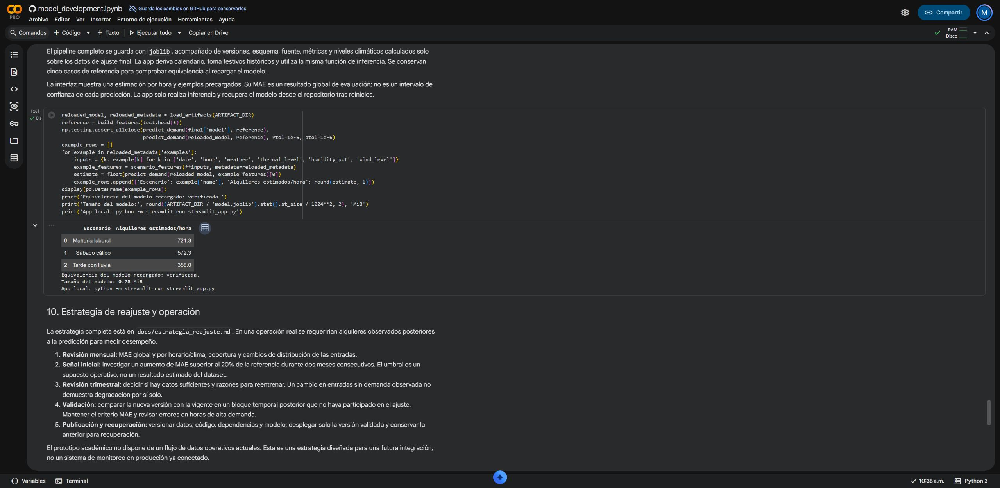

# Verificación de la entrega

Estado registrado el **12 de octubre de 2026**, zona horaria de Bogotá. El notebook y el modelo entregados provienen de una **ejecución real completa de Google Colab CPU**, entorno **`2026.07`**, Python **3.12.13**. Su carga y funcionamiento también se comprobaron en Windows con Python **3.12.14** y las mismas dependencias fijadas.

## Comprobaciones completadas

| Comprobación | Evidencia y resultado |
|---|---|
| Fuente original | ZIP y `hour.csv` con SHA-256 esperado; 17.379 registros horarios; ninguna fecha/hora duplicada. El CSV se vuelve a verificar antes de cada uso. |
| Cobertura temporal | 165 horas ausentes, que permanecen ausentes; particiones de 13.003, 2.208 y 2.168 filas, en orden y sin solapamiento. |
| Validación interna | Cinco bloques de 30 días completos, entrenamiento expansivo y dos días completos de separación; ningún bloque accede a validación externa o prueba. |
| Preparación sin fuga | Diez predictores; `cnt`, `casual`, `registered` e identificador excluidos. Cambiar esas columnas no cambia las entradas. El escalado se ajusta con entrenamiento y transformar datos futuros no modifica sus estadísticas. |
| Búsqueda y selección | 4/6/8 configuraciones para Ridge/Random Forest/Gradient Boosting; semilla 42; ganador seleccionado únicamente por MAE y RMSE de validación. |
| Notebook ejecutado | 40 celdas totales; en Colab real las 18 celdas de código tienen contadores 1–18 y ninguna salida de error. Entrenamiento completo; notebook con salidas y ZIP de resultados descargados. |
| Métricas independientes | Se recalculan MAE, RMSE y R² a partir de las predicciones guardadas; respuestas y marcas horarias coinciden con el bloque original de prueba. |
| Persistencia | Modelo de Colab guardado y recargado; cinco predicciones de referencia coinciden con tolerancias `rtol=1e-6`, `atol=1e-6`. Entorno, esquema y hash se validan antes de cargar. |
| Reproducción entre entornos | Métricas, predicciones de prueba, cinco referencias y SHA-256 del modelo de Colab coinciden exactamente con la ejecución local. El ZIP descargado contiene 28 archivos de `artifacts/`, `reportes/` y `figuras/`, importados a esta entrega. |
| Formulario | AppTest y revisión real en navegador; ejemplos Mañana laboral/Sábado cálido/Tarde con lluvia muestran 721/572/358 alquileres/hora redondeados. |
| Fallos y recuperación local | Rechazo de fechas fuera de 2011–2012, horas y humedad inválidas; mensajes ante artefactos ausentes o alterados; inicio de una sesión nueva; la app utiliza el modelo guardado sin descargar datos ni entrenar. |
| Suite | Modelo producido por Colab cargado en Windows Python 3.12.14: **48 pruebas aprobadas en 3,46 s**, mediante `python -m pytest -q`. |
| Documentación | Enlaces relativos comprobados; correspondencia con los apartados 3.1–3.9, estrategia de reajuste y guion de 120 segundos preparados. |
| Borrador de video | [Montaje de capturas locales](../media/demo_local_120s.mp4), duración 120,0 segundos, 1.920 × 1.080, 24 fps y sin audio; [SRT](../media/demo_local_120s.srt) y [metadatos](../media/demo_local_metadata.json) disponibles. Representa la app local. |

La comparación de prueba queda en [test_metrics.csv](../reportes/test_metrics.csv): Gradient Boosting presenta MAE **52,62**, RMSE **76,97** y R² **0,8542**. La mediana presenta MAE **158,81**; la reducción relativa del MAE es **66,87 %**. Véanse [el resumen de entrenamiento](../reportes/training_summary.json) y [la sustentación](sustentacion.md) para interpretar estas cifras y sus límites.

La captura muestra la recarga verificada y los tres escenarios; el notebook descargado conserva todas las salidas. Abrir [el notebook ejecutado en Colab](https://colab.research.google.com/github/Mateoloperaortiz/bike-demand-final-project/blob/main/model_development.ipynb) permite revisar el desarrollo; su preparación utiliza el código fijo de `v1.1` cuando se vuelve a ejecutar.

## Comprobaciones externas y entrega final

- [x] Repositorio público creado: [Mateoloperaortiz/bike-demand-final-project](https://github.com/Mateoloperaortiz/bike-demand-final-project).
- [x] Archivos publicados y tag `v1.0` accesible.
- [x] Código `v1.1` publicado y enlace abierto en Colab; los metadatos seleccionan CPU y entorno `2026.07`. El notebook ejecutado final se conserva en `main`; el código utilizado para entrenar queda fijado a `v1.1`.
- [x] Sesión real nueva en Google Colab, CPU, entorno `2026.07`, Python 3.12.13: ejecución completa tras instalar y reiniciar; notebook con salidas y ZIP de resultados descargados e importados.
- [ ] App publicada en Streamlit Community Cloud con un entorno compatible y URL comprobada.
- [ ] Acceso público en incógnito, sin autenticación del visitante, y ejemplos coherentes con la app local.
- [ ] Recuperación real tras reiniciar o despertar el alojamiento de Streamlit.
- [x] Borrador local de dos minutos generado, sin audio, con capturas reales, texto y subtítulos. No acredita un despliegue público.
- [ ] Video final de dos minutos de la app pública, revisado y accesible, que reemplace el borrador local. El [guion](guion_video.md) está preparado.

## Preparación de Colab y reinicio

La prueba real encontró **Python 3.13 en el entorno predeterminado**. Para conservar Python 3.12 entre entrenamiento y app, `v1.1` fija `runtime_attributes.runtime_version` a `2026.07`. La [FAQ oficial](https://research.google.com/colaboratory/runtime-version-faq.html) identifica esa versión con Python 3.12.13.

Antes de conectar, revisar **Entorno de ejecución → Cambiar tipo de entorno de ejecución**: Python 3, CPU y versión `2026.07`. Tras instalar, si la primera celda detecta bibliotecas antiguas ya cargadas y pide reinicio, usar **Reiniciar sesión** y **Ejecutar todas**. Ese procedimiento ya se verificó con una ejecución completa en Colab.

Las pruebas locales de sesión nueva no sustituyen una comprobación del alojamiento de Streamlit. La publicación de esa app, su acceso en incógnito y recuperación remota siguen pendientes; las casillas se actualizarán con evidencia al completar cada paso.
